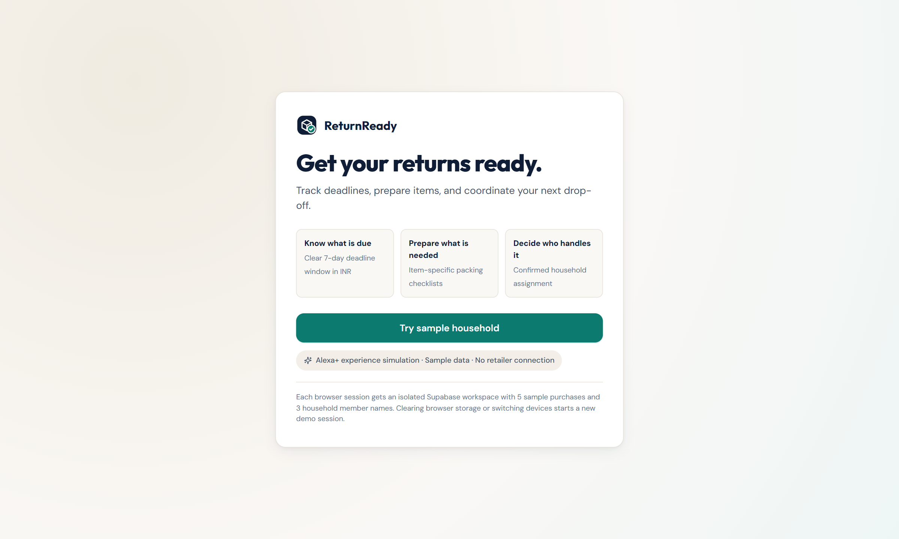
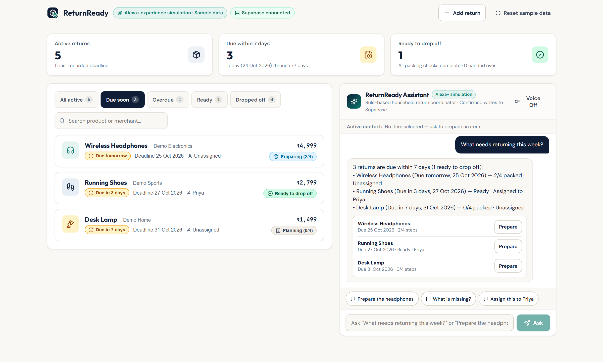
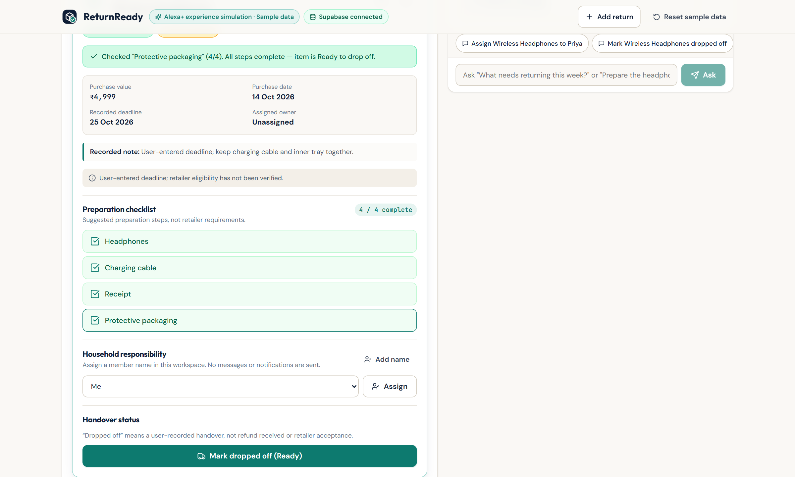
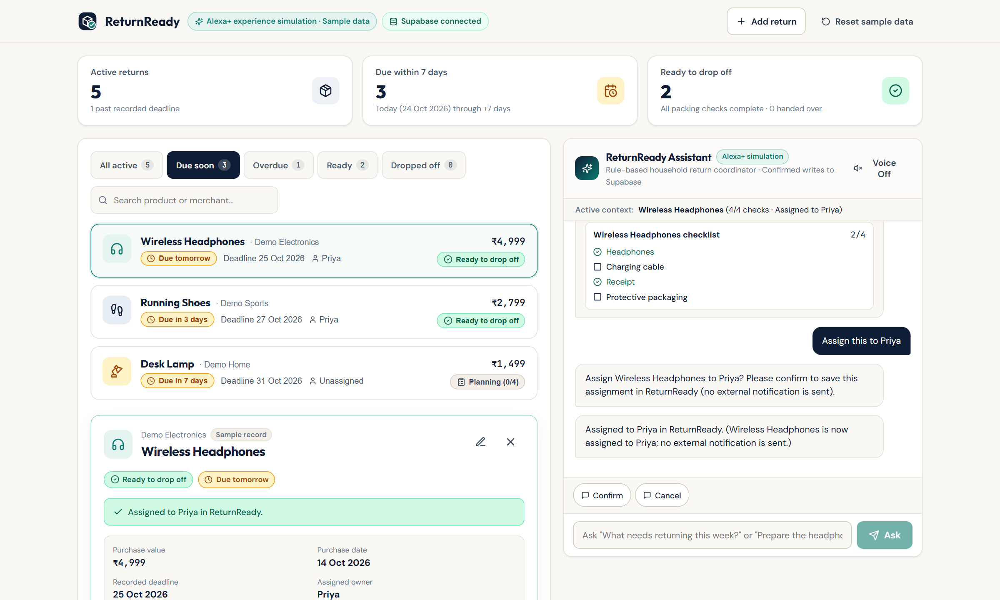
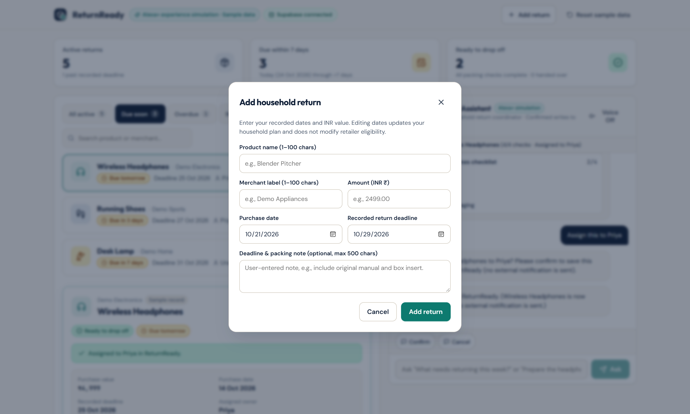

# ReturnReady — Your Household Returns Assistant

**App Developed by:** **Ritesh Kochar** (`@ensuredesign`) for **Build, Ship, Shape: Amazon Developer Hackathon** on **Oct 23, 2026**  
**Track:** Alexa+ Track (Simulated Experience Path)  
**Built With:** Google Antigravity, React 19, TypeScript 5.7, Vite 6, Supabase (Auth, PostgREST, PostgreSQL + RLS), Vitest, Playwright & Vercel

[](https://returnready.ensure.in/)
[-FF0000?style=for-the-badge&logo=youtube&logoColor=white)](https://youtu.be/GEOhZsTn5ME)
[](./LICENSE)

> **Simulation Notice:** Rule-based conversational simulation built using AI-assisted development in Google Antigravity; no live Alexa backend or LLM runtime. Sample data is provided for instant testing; ReturnReady does not connect to retailer accounts, verify return-policy eligibility, process refunds, book couriers, or send external notifications.

---

## 🎥 Watch the Demo Video

- **YouTube Demo Video (2:21):** [**https://youtu.be/GEOhZsTn5ME**](https://youtu.be/GEOhZsTn5ME)
- **Live Deployed Application:** [**https://returnready.ensure.in/**](https://returnready.ensure.in/)
- **GitHub Repository:** [**https://github.com/ensuredesign/returnready**](https://github.com/ensuredesign/returnready)

[](https://youtu.be/GEOhZsTn5ME)

---

## 1. Product Goal & Core Promise

**ReturnReady** helps a household turn an intention to return a purchase into a prepared, assigned task. Household returns frequently fail because a return deadline is forgotten, packing accessories (such as a charging cable or power adapter) are left behind, or responsibility is unclear between family members.

> **Core Promise:** *Know what is due, prepare what is needed, and decide who will handle it.*

---

## 2. Visual Feature Walkthrough & Screenshots

### 2.1 Architecture, Tech Stack & 6-Step User Journey

- **What it shows:** End-to-end flow from one-click isolated session bootstrap (`rr_bootstrap_demo()`) through contextual Alexa+ conversational intents (`list_due`, `missing_checks`), atomic checklist persistence (`rr_set_checklist()`), version-bound confirmation (`rr_confirm_action()`), and PostgreSQL Row Level Security (`RLS`).

---

### 2.2 Screen A — Zero-Friction Isolated Demo Entry

- **One-Click Judge Onboarding:** Clicking **“Try sample household”** establishes an isolated Supabase-authenticated browser session (`ensureDemoSession()`) and runs the transactional `rr_bootstrap_demo()` RPC in PostgreSQL.
- **Idempotent Seeding:** Seeds 1 workspace (`Asia/Kolkata` timezone), 3 assignable household member names (`Me`, `Priya`, `Alex`), and 5 realistic sample purchases in Indian Rupees (`₹`) with item-specific packing checklists. Reloading or double-clicking reuses the existing session without duplicating rows.
- **Clear Simulation Disclosure:** Displays `Alexa+ experience simulation · Sample data · No retailer connection` prominently on entry.

---

### 2.3 Screen B — Main Household Workspace & 7-Day Deadline Window

- **Summary Cards:** Displays real-time counts for **Active returns**, **Due within 7 days** (today through today + 7 calendar days inclusive in `Asia/Kolkata`), and **Ready to drop off** (all packing steps completed).
- **Filters & Case-Insensitive Search:** Filter returns by **All active**, **Due soon**, **Overdue**, **Ready**, and **Dropped off**, or search by product name and merchant label.
- **Contextual Alexa+ Assistant Panel:** Asking *"What needs returning this week?"* filters the dashboard to the inclusive 7-day window and renders a structured summary card with quick **Prepare** actions.

---

### 2.4 Screen C — Item Details, Packing Checklist & Derived “Ready” Status

- **Contextual Item Selection (`Prepare the headphones` → `What is missing?`):** Selecting an item opens its detail panel showing purchase value (`₹4,999`), purchase date, recorded return deadline, deadline note, and the explicit notice: *"User-entered deadline; retailer eligibility has not been verified."*
- **Atomic Checklist Persistence:** Each step (*Headphones*, *Charging cable*, *Receipt*, *Protective packaging*) toggles independently via `rr_set_checklist(check_id, checked)`, disables duplicate clicks while saving, retains prior state on network error, and increments the parent return's `version`.
- **Derived “Ready to drop off” Badge:** Stored statuses are `planning`, `preparing`, and `dropped_off`. When all checklist items are checked (`4 / 4 complete`), ReturnReady automatically derives the visible **Ready to drop off** state; unchecking any step removes Ready immediately.

---

### 2.5 Confirmed Household Assignment & Optimistic Concurrency

- **Version-Bound Pending Actions:** Asking *"Assign this to Priya"* (or using the household member selector) never mutates the database without explicit confirmation. It creates a `PendingAction` bound to `itemId`, `memberId`, and `expectedVersion` with a 5-minute TTL.
- **Database Version Revalidation:** Clicking **Confirm** invokes `rr_confirm_action()`, which verifies `v_return.version = expected_version` inside PostgreSQL before recording `Assigned to Priya in ReturnReady`.
- **Survives Browser Refresh:** All checklist toggles, assignments, and drop-off timestamps persist in Supabase PostgreSQL and reload automatically in the same browser session.

---

### 2.6 Add / Edit Household Return Modal (P1 Feature)

- **Custom Purchases & Household Members:** Users can click **“+ Add return”** (or the **Edit** icon on any return, or **“+ Add name”** under *Household responsibility*) to create or update returns with Zod schema validation, integer paise currency conversion (`amount_minor`), calendar date validation (`return_deadline >= purchase_date`), and unsaved-changes discard confirmation.

---

## 3. Technology Stack

| Layer | Technology | Role in ReturnReady |
|---|---|---|
| **Agentic IDE** | **Google Antigravity** | Full-stack architecture, SQL/RLS authoring, UI implementation & automated test verification |
| **Frontend UI** | **React 19 + TypeScript 5.7** | Split-screen workspace, item detail drawer, deterministic conversational intent router |
| **Build Tooling** | **Vite 6** | Fast HMR development server and static production bundling |
| **Backend & Auth** | **Supabase (`@supabase/supabase-js`)** | Per-session JWT authentication, PostgREST Data API, and RPC invocation |
| **Database & Security** | **PostgreSQL 15+ (RLS + PL/pgSQL)** | Scoped `rr_*` tables, Row Level Security (`auth.uid()`), composite FKs, version triggers & transactional RPCs |
| **Validation & Icons** | **Zod + Lucide React** | Form/currency validation and accessible original category iconography |
| **Automated Testing** | **Vitest + Testing Library + Playwright** | 24 unit/component tests + 2 live two-session Supabase RLS integration tests + E2E browser journey |
| **Deployment** | **Vercel** | Production SPA hosting at [`https://returnready.ensure.in/`](https://returnready.ensure.in/) |

---

## 4. Reproducible Local Setup

Follow these steps from a fresh clone:

### Step 1 — Clone & Install Dependencies
```bash
git clone https://github.com/ensuredesign/returnready.git
cd returnready
npm install
```

### Step 2 — Configure Dedicated Supabase Project & Auth
1. Create or select a dedicated Supabase project.
2. In Supabase Dashboard → **Authentication → Providers**, enable **Anonymous Sign-Ins** (ReturnReady also includes an automatic fallback to isolated ephemeral authenticated sessions if `anonymous_users` is disabled on a self-hosted GoTrue instance with `phone_autoconfirm` enabled).

### Step 3 — Apply Versioned Database Migration
Apply [`supabase/migrations/20261023000001_returnready_schema.sql`](./supabase/migrations/20261023000001_returnready_schema.sql) via **either**:
- **Supabase Studio SQL Editor:** Open **SQL Editor → New query**, paste the contents of [`supabase/migrations/20261023000001_returnready_schema.sql`](./supabase/migrations/20261023000001_returnready_schema.sql), and click **Run**.
- **Supabase CLI:**
  ```bash
  npx supabase db push
  ```

### Step 4 — Configure Environment Variables
Copy `.env.example` to `.env` and fill in your Supabase URL and publishable/anon key (never place a `service_role` or secret key in `.env`):

```bash
cp .env.example .env
```

```dotenv
VITE_SUPABASE_URL=https://your-project.supabase.co
VITE_SUPABASE_PUBLISHABLE_KEY=your-publishable-or-anon-key
```

### Step 5 — Run the App & Verification Suite
```bash
npm run dev
```
Open `http://localhost:5173` and click **Try sample household**.

To run all verification checks:
```bash
npm run typecheck
npm run lint
npm test
npm run build
npm run test:integration
npm run test:e2e
```

---

## 5. Technical Documentation Index

All project and hackathon documentation is maintained in [`docs/`](./docs/):

- [**Architecture Overview (`docs/ARCHITECTURE.md`)**](./docs/ARCHITECTURE.md) — System diagram, RLS policies, composite FKs, triggers, and transactional RPC specifications.
- [**Product Requirements Reference (`docs/PRD.md`)**](./docs/PRD.md) — Summary of functional requirements (`FR-01`–`FR-07`), acceptance tests (`A01`–`A20`), and visual walkthrough.
- [**Full PRD & Build Prompt (`ReturnReady_PRD_and_Antigravity_Prompt.md`)**](./ReturnReady_PRD_and_Antigravity_Prompt.md) — Complete specification used to build ReturnReady.
- [**Demo Video Script & Storyboard (`docs/DEMO_SCRIPT.md`)**](./docs/DEMO_SCRIPT.md) — Scene-by-scene narration for [https://youtu.be/GEOhZsTn5ME](https://youtu.be/GEOhZsTn5ME).
- [**Devpost Submission Package (`docs/SUBMISSION_DRAFT.md`)**](./docs/SUBMISSION_DRAFT.md) — Complete project story, track details, and questionnaire responses.
- [**Product Feedback (`docs/PRODUCT_FEEDBACK.md`)**](./docs/PRODUCT_FEEDBACK.md) — Developer tool feedback on Google Antigravity, Supabase, Vite, React & TypeScript.
- [**Friction Log (`docs/FRICTION_LOG.md`)**](./docs/FRICTION_LOG.md) — Detailed friction log entries (`FL-01`–`FL-03`) with severity, workarounds, and suggestions.
- [**Test Results & Verification Report (`docs/TEST_RESULTS.md`)**](./docs/TEST_RESULTS.md) — Exact commands and verified pass outputs for typecheck, lint, unit, build, and live two-session RLS integration tests.

---

## 6. Author & License

- **Developed by:** **Ritesh Kochar** (`@ensuredesign`)
- **Hackathon:** Build, Ship, Shape: Amazon Developer Hackathon (Oct 23, 2026)
- **License:** [MIT License](./LICENSE)
