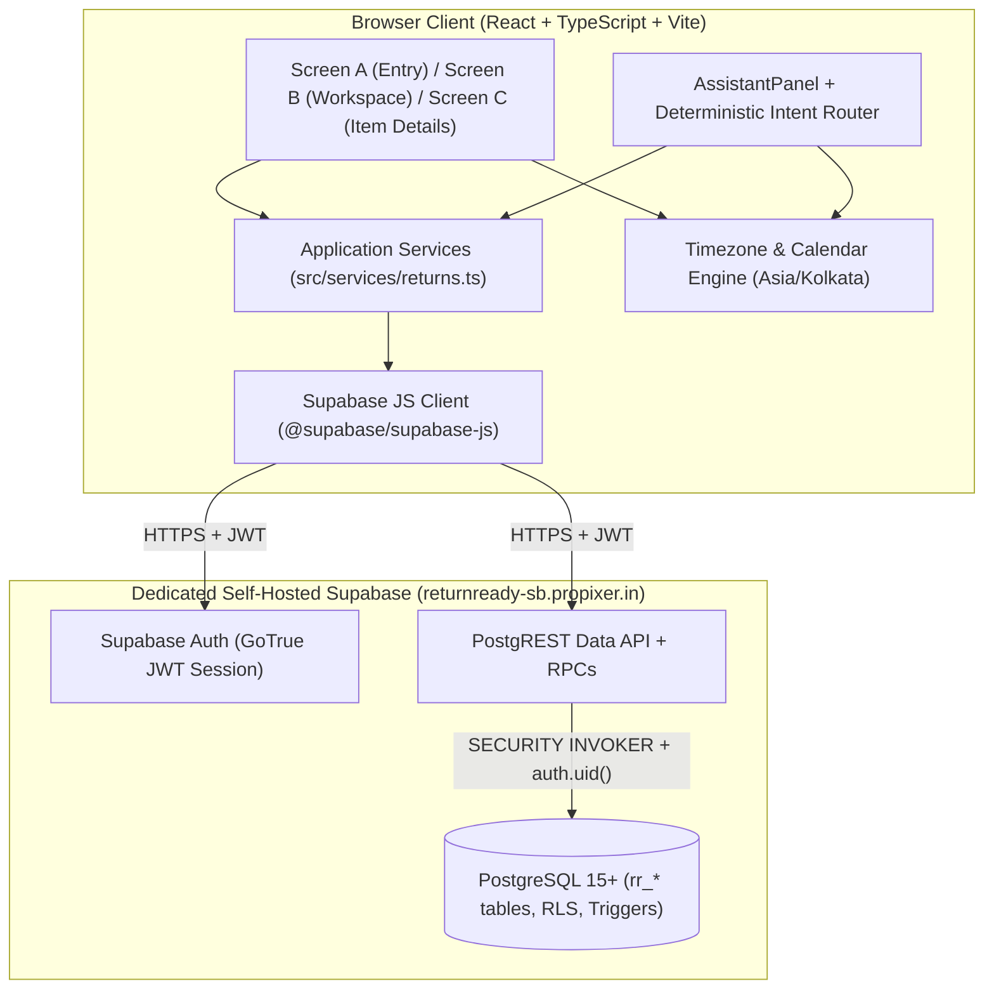

# ReturnReady — Architecture Overview

**Project:** ReturnReady — Your Household Returns Assistant  
**Track:** Amazon Developer Hackathon (Alexa+ simulated web experience)  
**Stack:** React 19, TypeScript 5.7, Vite 6, Supabase (`@supabase/supabase-js` + PostgreSQL + Auth + RLS)

---

## 1. High-Level System Architecture

---

## 2. Core Architectural Decisions

### 2.1 Rule-Based Conversational Simulation (No LLM Runtime Dependency)
- **Why:** ReturnReady demonstrates a deterministic, reliable Alexa+ household coordination pattern: retrieving structured household state (`list_due`, `list_overdue`, `missing_checks`) and proposing version-bound mutations (`propose_assignment`, `propose_dropoff`, `propose_reopen`) that require explicit user confirmation before writing.
- **Shared Execution Path:** Conversational intents and UI buttons invoke the exact same service functions (`setChecklistItem`, `assignReturn`, `markDroppedOff`, `reopenReturn`), guaranteeing consistent state transitions and error handling.

### 2.2 Session-Isolated Demo Workspaces via Supabase Auth & RLS
- **Authentication:** Clicking **“Try sample household”** checks `supabase.auth.getSession()` first so page reloads reuse the existing session without creating duplicate users. If no session exists, it calls `signInAnonymously()` (with automatic fallback to an isolated ephemeral authenticated session via GoTrue `phone_autoconfirm` when `anonymous_users` is disabled on a self-hosted instance).
- **Row Level Security (RLS):** Every table (`rr_workspaces`, `rr_members`, `rr_returns`, `rr_checklist_items`) has RLS enabled, all `PUBLIC` and `anon` table privileges revoked, and policies restricted `TO authenticated` checking workspace ownership against `(SELECT auth.uid())`.
- **Composite Foreign Keys:**
  - `rr_returns(workspace_id, assignee_id)` references `rr_members(workspace_id, id) ON DELETE RESTRICT`, preventing cross-workspace member assignment at the database constraint level.
  - `rr_checklist_items(workspace_id, return_id)` references `rr_returns(workspace_id, id) ON DELETE CASCADE`.

### 2.3 Transactional RPCs & Optimistic Concurrency Control
All multi-statement database writes execute inside `SECURITY INVOKER` PL/pgSQL functions:
1. `rr_bootstrap_demo()`: Acquires a per-user transaction advisory lock (`pg_advisory_xact_lock`) and seeds 1 workspace, 3 household member names (`Me`, `Priya`, `Alex`), and 5 sample returns with checklists relative to `(now() AT TIME ZONE 'Asia/Kolkata')::date` only if the user has no workspace.
2. `rr_reset_demo()`: Locks and resets only the caller's workspace and re-anchors sample dates to today in `Asia/Kolkata`.
3. `rr_set_checklist(check_id, checked)`: Verifies ownership and non-`dropped_off` status, updates the checklist item, and triggers a parent `rr_returns` update that increments `version` and moves `planning` → `preparing`.
4. `rr_confirm_action(item_id, action, member_id, expected_version)`: Verifies caller ownership and compares `rr_returns.version` against `expected_version`. If the item changed since confirmation was requested (including checklist edits), it raises SQLSTATE `40001` (`CONFLICT`) and prompts for a fresh confirmation.

### 2.4 Derived Status & Calendar-Only Deadlines
- **Stored vs. Derived Status:** The database stores `'planning'`, `'preparing'`, or `'dropped_off'`, with a `CHECK` constraint enforcing `dropped_off_at IS NOT NULL` iff `status = 'dropped_off'`. The UI and service layer derive the visible **Ready** status whenever `status !== 'dropped_off'`, `checklist.length > 0`, and every checklist step is checked.
- **Calendar Boundaries:** Deadlines are stored as PostgreSQL `DATE` (`YYYY-MM-DD`) and compared against today's date in `Asia/Kolkata` using calendar arithmetic rather than millisecond division.
