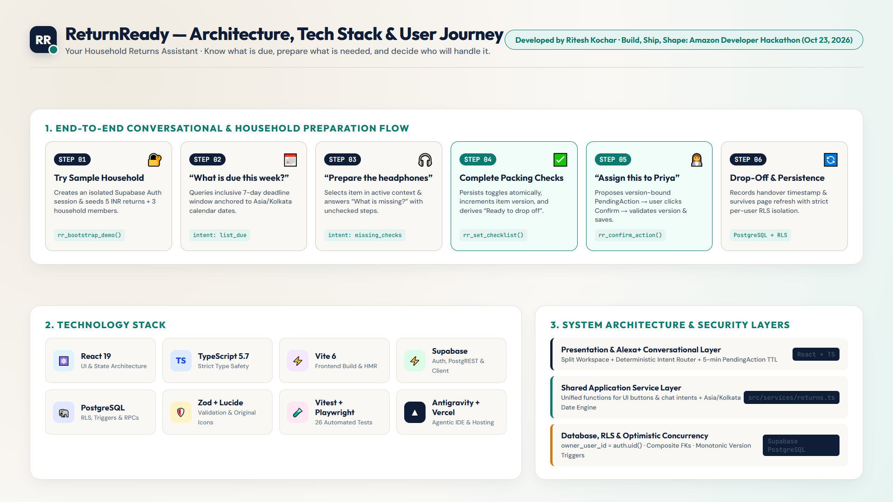
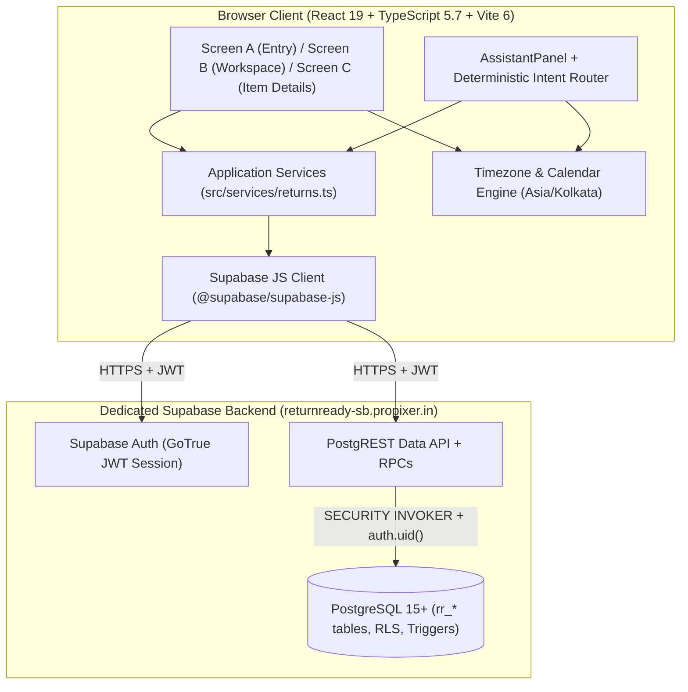

# ReturnReady — Architecture Overview

**App Developed by:** **Ritesh Kochar** (`@ensuredesign`) for **Build, Ship, Shape: Amazon Developer Hackathon** on **Oct 23, 2026**  
**Track:** Alexa+ Track (Simulated Experience Path)  
**Live App:** [https://returnready.ensure.in/](https://returnready.ensure.in/) · **Demo Video:** [https://youtu.be/GEOhZsTn5ME](https://youtu.be/GEOhZsTn5ME) · **Repo:** [https://github.com/ensuredesign/returnready](https://github.com/ensuredesign/returnready)

---

## 1. Visual Architecture, Tech Stack & User Flow

---

## 2. System Topology

---

## 3. Core Architectural Decisions

### 3.1 Rule-Based Conversational Simulation (Shared Service Contract)
- **Deterministic Intent Router (`src/features/assistant/intentRouter.ts`):** Handles natural household return queries (`list_due`, `list_overdue`, `list_ready`, `list_dropped_off`, `list_all`, `select_item`, `missing_checks`, `propose_assignment`, `propose_dropoff`, `propose_reopen`, `confirm_pending`, `cancel_pending`, `ambiguous_mutation`, `help`) without requiring a live LLM API key or external retailer connection.
- **Unified Service Layer (`src/services/returns.ts`):** Both conversational intents and UI buttons invoke the exact same service functions (`setChecklistItem`, `assignReturn`, `markDroppedOff`, `reopenReturn`, `createPurchase`, `updatePurchase`, `addHouseholdMember`).

### 3.2 Session-Isolated Demo Workspaces via Supabase Auth & RLS
- **Session Lifecycle (`src/lib/supabase.ts`):** Clicking **“Try sample household”** checks `supabase.auth.getSession()` first so page reloads reuse the existing session without creating duplicate users. If absent, it calls `signInAnonymously()` (with automatic fallback to an isolated ephemeral authenticated session via GoTrue `phone_autoconfirm` when `anonymous_users` is disabled on a self-hosted instance).
- **Row Level Security (`RLS`):** Every table (`rr_workspaces`, `rr_members`, `rr_returns`, `rr_checklist_items`) has RLS enabled, all `PUBLIC` and `anon` privileges revoked, and `SELECT`/`INSERT`/`UPDATE`/`DELETE` policies restricted `TO authenticated` checking `owner_user_id = (SELECT auth.uid())`.
- **Composite Foreign Keys:**
  - `rr_returns(workspace_id, assignee_id)` references `rr_members(workspace_id, id) ON DELETE RESTRICT`, preventing cross-workspace member assignment at the database constraint level (`A16`).
  - `rr_checklist_items(workspace_id, return_id)` references `rr_returns(workspace_id, id) ON DELETE CASCADE`.

### 3.3 Transactional PL/pgSQL RPCs & Optimistic Concurrency Control
All multi-statement database writes execute inside `SECURITY INVOKER` PL/pgSQL functions (`supabase/migrations/20261023000001_returnready_schema.sql`):
1. `rr_bootstrap_demo()`: Acquires a per-user transaction advisory lock (`pg_advisory_xact_lock`) and seeds 1 workspace, 3 household member names (`Me`, `Priya`, `Alex`), and 5 sample returns with checklists relative to `(now() AT TIME ZONE 'Asia/Kolkata')::date` only if the user has no workspace.
2. `rr_reset_demo()`: Locks and resets only the caller's workspace and re-anchors sample dates to today in `Asia/Kolkata`.
3. `rr_set_checklist(check_id, checked)`: Verifies ownership and non-`dropped_off` status, updates the checklist item, and triggers a parent `rr_returns` update that increments `version` and moves `planning` → `preparing`.
4. `rr_confirm_action(item_id, action, member_id, expected_version)`: Verifies caller ownership and compares `rr_returns.version` against `expected_version`. If the item changed since confirmation was requested, it raises SQLSTATE `40001` (`CONFLICT`) and prompts for a fresh confirmation.

### 3.4 Derived Status & Calendar-Only Deadlines
- **Stored vs. Derived Status:** PostgreSQL stores `'planning'`, `'preparing'`, or `'dropped_off'`, with a `CHECK` constraint enforcing `dropped_off_at IS NOT NULL` iff `status = 'dropped_off'`. The service layer derives the visible **Ready to drop off** status whenever `status !== 'dropped_off'`, `checklist.length > 0`, and every checklist step is checked.
- **Calendar Boundaries (`src/lib/dates.ts`):** Deadlines are stored as PostgreSQL `DATE` (`YYYY-MM-DD`) and compared against today's date in `Asia/Kolkata` using UTC Julian calendar day differences rather than millisecond division.
