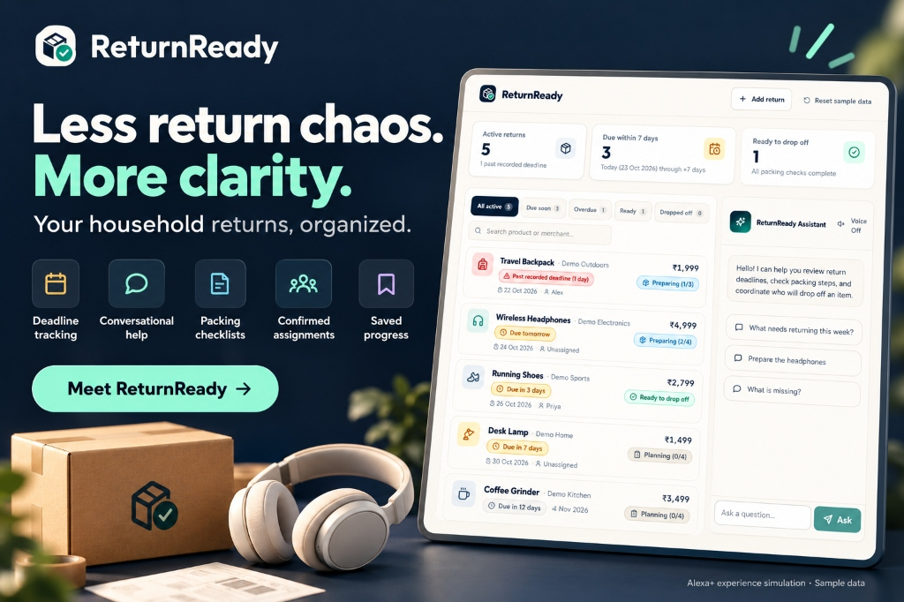
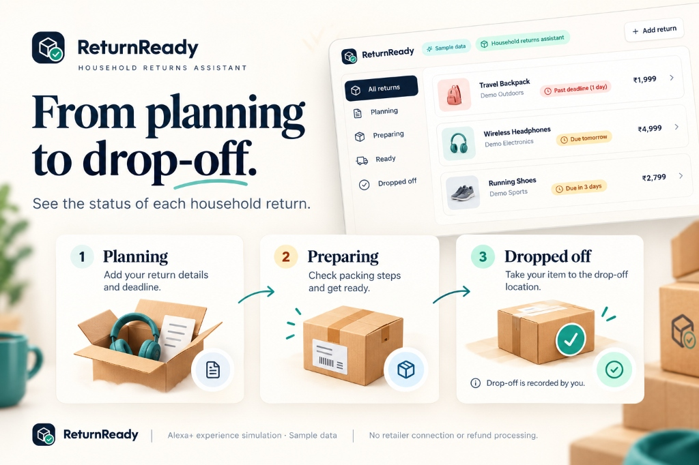
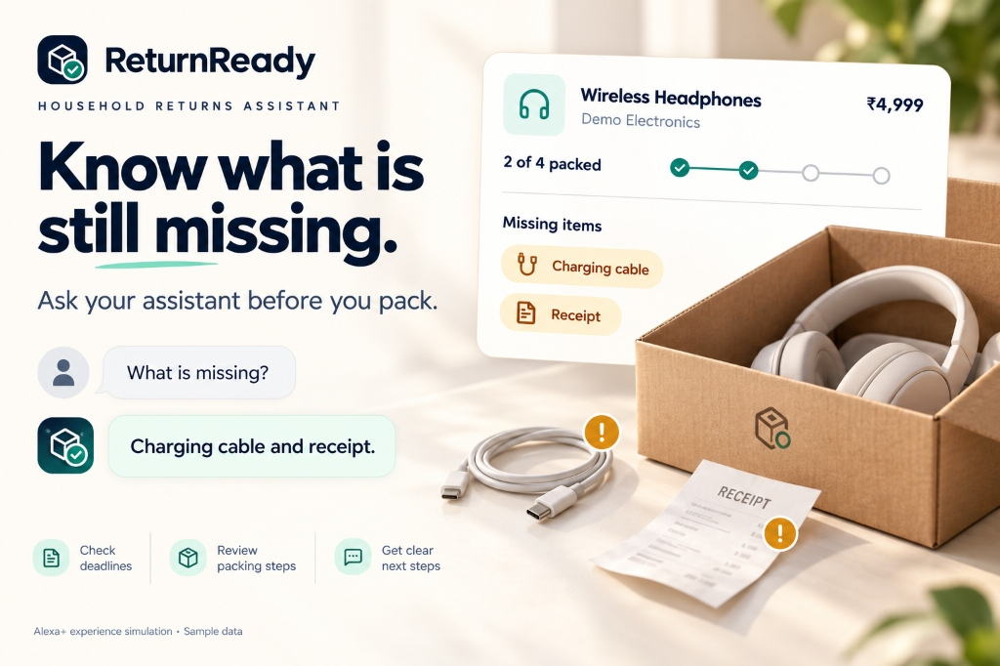
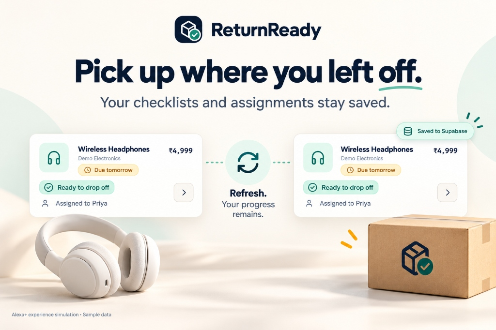
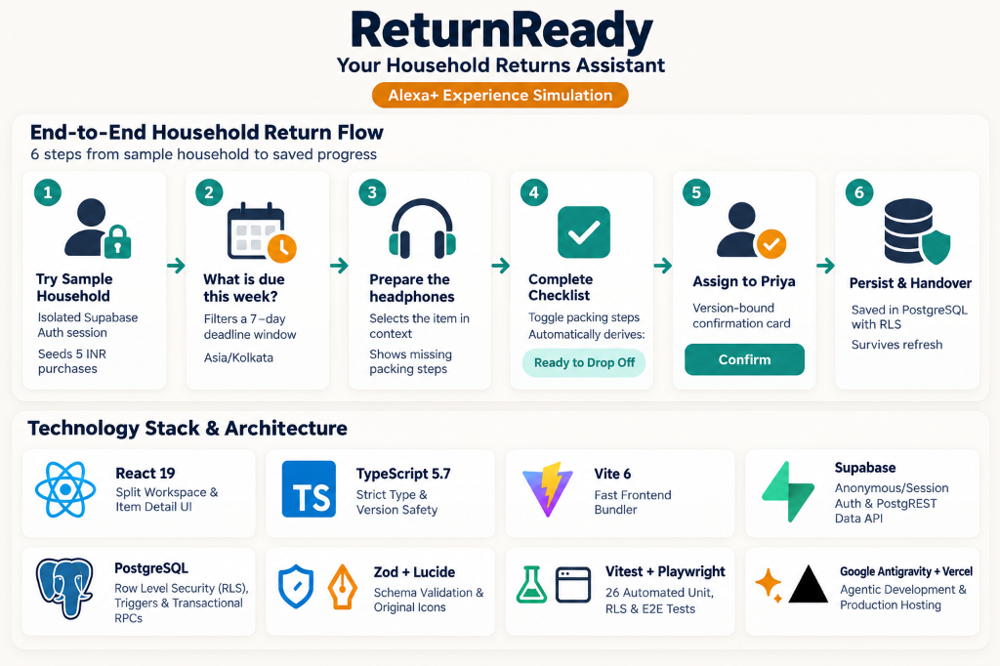

# ReturnReady — Devpost Submission Reference

> **App Developed by:** Ritesh Kochar for **Build, Ship, Shape: Amazon Developer Hackathon** on Oct 23, 2026  
> **Official Hackathon Page:** [https://amazonappdev2026.devpost.com/](https://amazonappdev2026.devpost.com/)  
> **Official YouTube Demo Video:** [https://youtu.be/GEOhZsTn5ME](https://youtu.be/GEOhZsTn5ME)  
> **Live Web Application:** [https://returnready.ensure.in/](https://returnready.ensure.in/)  
> **GitHub Repository:** [https://github.com/ensuredesign/returnready](https://github.com/ensuredesign/returnready)

---

## Basic Submission Fields

- **Project Name:** ReturnReady — Your Household Returns Assistant
- **Elevator Pitch:** An Alexa+ experience prototype that helps households track return deadlines, prepare packing checklists, and coordinate drop-offs through simple conversations.
- **Primary Track:** Alexa+ (simulated web experience built with Google Antigravity)
- **Built With Tags:** `google-antigravity`, `react`, `typescript`, `vite`, `supabase`, `postgresql`, `vitest`, `playwright`, `vercel`
- **GitHub Repository URL:** `https://github.com/ensuredesign/returnready`
- **Public Demo Video URL:** `https://youtu.be/GEOhZsTn5ME`
- **Live App URL:** `https://returnready.ensure.in/`
- **Developer:** Ritesh Kochar (Individual Participant, India — Built on Oct 23, 2026)

---

## Visual Feature Gallery

### 1. Organized Household Returns Workspace & Alexa+ Assistant

### 2. Return Lifecycle — From Planning to Drop-Off

### 3. Contextual Missing-Steps Assistant & Packing Checklists

### 4. Persistent Checklists & Confirmed Household Assignments

### 5. End-to-End Household Return Flow & Technology Stack

---

## Project Story

### Inspiration
Online shopping makes buying effortless, but returning an item inside a busy household often falls apart for mundane reasons: the return window closes while the box sits by the door, a power adapter or charging cable is left behind on a desk, or two family members each assume the other person handled the drop-off.

I wanted to explore a practical, grounded **Alexa+ household assistant use case**: turning an intention to return an item into a prepared, assigned errand. The core promise is simple: **Know what is due, prepare what is needed, and decide who will handle it.**

### What It Does
**ReturnReady** is a web-based Alexa+ experience simulation backed by a real Supabase PostgreSQL database:
- **Zero-Friction Isolated Demo Household:** Clicking **“Try sample household”** establishes an isolated Supabase-authenticated browser session and runs a transactional bootstrap (`rr_bootstrap_demo`) that seeds five sample purchases in INR (`₹`) and three assignable household member names (`Me`, `Priya`, `Alex`).
- **Clear Deadline Windows in `Asia/Kolkata`:** Displays active returns sorted by earliest user-recorded deadline, with filters for **All active**, **Due soon** (today through today + 7 calendar days, inclusive), **Overdue** (past the user-recorded deadline), **Ready**, and **Dropped off**.
- **Item-Specific Packing Checklists & Derived “Ready” Status:** Each return has a preparation checklist (such as `Headphones`, `Charging cable`, `Receipt`, and `Protective packaging`). Toggling steps persists immediately to Supabase. When every step is checked on an active return, ReturnReady derives the **Ready to drop off** state; unchecking a step removes Ready immediately:
  $$\text{Ready}(r) \iff \left(r.\text{status} \neq \text{dropped\_off}\right) \land \left(|C_r| \ge 1\right) \land \left(\forall c \in C_r,\; c.\text{is\_checked} = \text{true}\right)$$
- **Contextual Rule-Based Conversation:** Users can interact through natural requests such as:
  - *"What needs returning this week?"*
  - *"Prepare the headphones"*
  - *"What is missing?"*
  - *"Assign this to Priya"*
  - *"Mark the headphones dropped off"*
- **Confirmed Mutations with Version Checks:** Mutations proposed in conversation or UI buttons create a version-bound pending confirmation (`assign`, `dropoff`, `reopen`) that expires after 5 minutes, cancels if an unrelated command is entered, and revalidates the item's database `version` before writing.
- **Honest Scope Guardrails:** ReturnReady clearly labels sample data and user-recorded deadlines. It does not claim to connect to Amazon or retailer accounts, verify return policy eligibility, book couriers, track refunds, or send SMS/email notifications.

### How It Was Built
- **Google Antigravity:** Used to design the architecture, author the PostgreSQL schema and RLS policies, build the React + TypeScript frontend, and write the unit, integration, and Playwright end-to-end test suites.
- **Frontend:** Built with React 19, TypeScript 5.7, Vite 6, Zod validation, and Lucide icons, styled with a warm off-white, deep navy, and teal palette designed for accessibility (44px minimum touch targets, icon+text badges that never rely on color alone, keyboard `Escape` support, and focus restoration).
- **Supabase Backend:**
  - Four scoped tables (`rr_workspaces`, `rr_members`, `rr_returns`, `rr_checklist_items`) protected by Row Level Security (`TO authenticated`, checking `owner_user_id = (SELECT auth.uid())`).
  - Composite foreign keys (`(workspace_id, assignee_id)` and `(workspace_id, return_id)`) preventing cross-workspace references at the database layer.
  - Database triggers that enforce non-editable checklists on dropped-off returns and monotonically increment `rr_returns.version` on both return updates and checklist toggles.
  - Four `SECURITY INVOKER` PL/pgSQL RPCs (`rr_bootstrap_demo`, `rr_reset_demo`, `rr_set_checklist`, `rr_confirm_action`).

### Challenges Faced
1. **Stale Confirmation Safety:** When a user asks *"Assign this to Priya"* and then modifies a checklist step before clicking *Confirm*, the underlying record state has changed. I solved this by incrementing the parent return's `version` inside an `AFTER UPDATE` trigger on `rr_checklist_items` and checking `expected_version` inside `rr_confirm_action` before committing.
2. **Timezone-Safe Calendar Boundaries:** Computing "due within 7 days" by dividing timestamps by `86,400,000` milliseconds causes off-by-one bugs around midnight between UTC and IST (`Asia/Kolkata`). I implemented pure calendar-date arithmetic anchored to `Asia/Kolkata` in both PostgreSQL (`(now() AT TIME ZONE 'Asia/Kolkata')::date`) and TypeScript (`Intl.DateTimeFormat` + UTC Julian day differences).
3. **Self-Hosted Supabase Auth & Kong Configuration:** While configuring the dedicated self-hosted Supabase instance (`returnready-sb.propixer.in`), Kong's default `request-termination` plugin blocked the `/mcp` endpoint with HTTP `403`, and GoTrue's `ENABLE_ANONYMOUS_USERS` flag defaulted to `false` while `phone_autoconfirm` was `true`. I documented this in [`docs/FRICTION_LOG.md`](./FRICTION_LOG.md), provided the versioned SQL migration for direct execution, and added an automatic ephemeral session fallback so visitors always receive a genuine `authenticated` Supabase JWT session isolated by `auth.uid()`.

### Accomplishments
- **Unified Service Contract:** Conversational prompts and UI controls call the exact same TypeScript service functions and PostgreSQL RPCs—there is no mocked chat state diverging from database state.
- **Defense-in-Depth Isolation:** Workspace isolation is enforced simultaneously by Supabase Auth JWTs, RLS `USING`/`WITH CHECK` policies, and composite foreign keys.
- **Tested End-to-End Reliability:** 24 unit and component tests plus 2 live two-session Supabase RLS integration tests verify date boundaries, derived Ready status, conversational intents, network error state retention, and stale version conflicts.

---

*App Developed by: Ritesh Kochar for Build, Ship, Shape: Amazon Developer Hackathon on Oct 23, 2026*
